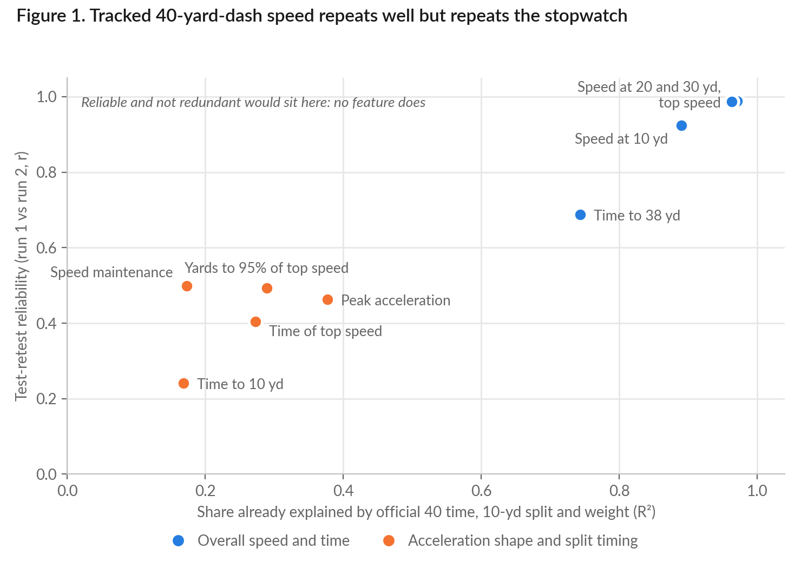
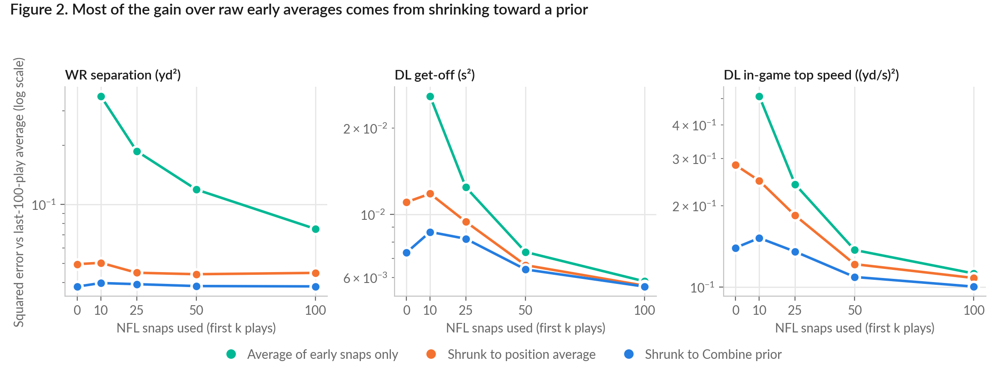
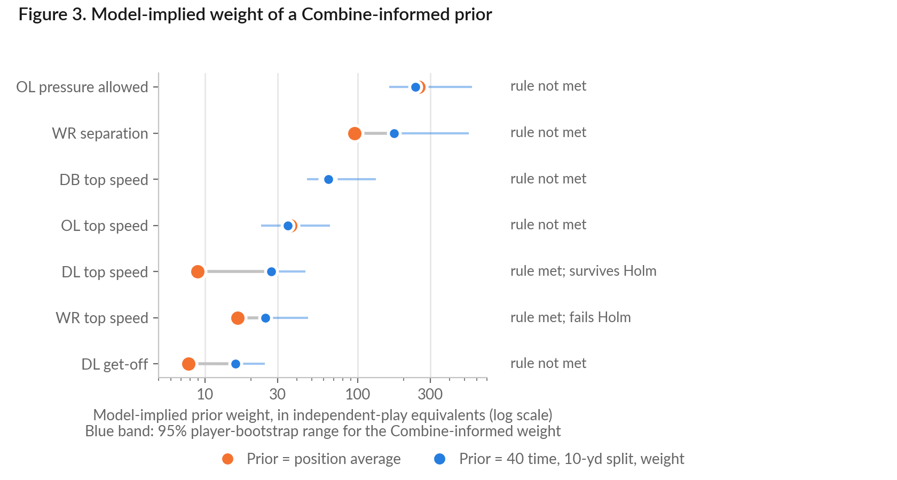
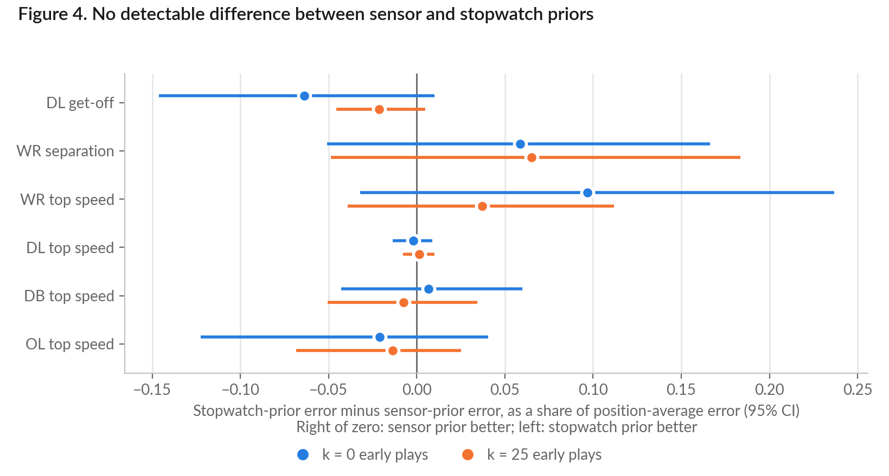

# What Is a Combine-Informed Prior Worth Once the Season Starts?

*An exploratory, player-level test of how Combine measurements, including tracking data, relate to NFL play. Claims are sized to about 60 players per position.*

## The short answer

Rookies arrive with few NFL snaps and a Combine file. We join Combine tracking and official results to the same players' regular-season tracking (510 players drafted 2023-25; 418 with a tracked 40-yard dash) and test whether a prior built from Combine numbers predicts a player's later play better than the position average does. We also report a model-implied prior weight, n0, in independent-play equivalents.

- **Only DL top speed meets our pre-set rule after Holm correction (adjusted p < .001).** At k = 0 the Combine-informed prior cuts held-out squared error from .284 to .140, and n0 rises from 9 to 27 (95% range 21-45). Body weight alone does as well, so this may reflect role (edge vs interior) rather than speed; we did not test alignment.
- **WR top speed meets the rule but not after Holm** (adjusted p = .077). DL get-off and WR separation do not meet it, and WR separation's gain is concentrated in a few players.
- **No predictive improvement was detected** for DB top speed, OL top speed or OL pressure allowed.
- **Tracking:** we detected no difference between a sensor-based and a stopwatch-based prior, and the tracking-derived shape features gave no detectable incremental improvement.
- **Early averages alone are poor.** Across eligible receivers, first-10-route separation averages had mean squared error .356 yd² against last-100-route averages; shrinking to the position average gives .050 and adding the Combine prior .040. Nearly all of that gain is shrinkage.

For a rookie with few qualifying snaps, this framework could stabilise a descriptive movement estimate. It does not justify changing a depth chart, a pass-rush assignment or a player grade.

## Data and the Combine-to-NFL link

- **Players.** 510 drafted players (DB 122, DL 118, OL 121, WR 107, TE 42). Only 54-66 per position (TE 21) have 100 or more usable plays.
- **Combine side.** `combine_tracking` for the 40-yard dash (793 runs, 418 players) and official results from `combine_results`.
- **NFL side.** `game_tracking_2023-25` gives per-play maximum speed (about 251,000 player-plays, 401 players; split-half reliability of the player average 0.98). `player_play` gives DL get-off time (NGS, lower is faster), WR separation at pass forward (adjusted for route, cushion, coverage and alignment) and OL pressure allowed (a per-snap flag). These are descriptive measures, not context-free grades.
- **The link** is the player ID; the player is the unit of analysis. Position is the Combine label, not play-level alignment. Combine drills are standardised, though participation varies.

Combine clips start with the athlete already moving, so tracked 40 *times* are not comparable to official times; we use downfield position and speed levels.

## How decisions were fixed

Rules were written in dated notes, self-recorded rather than registered with a third party, so we call them "pre-set". Test 1's preceded any analysis relating outcomes to Combine features. Test 2's were written after test 1's null, and file timestamps cannot exclude that an exploratory run came first. The Holm correction, the weight ablation, the influence checks and the sensor arm were added afterwards. All results here are exploratory.

## Does the sensor measure something the stopwatch does not?

Figure 1 (pooled across positions) plots ten tracked 40-yard-dash features: repeatability across two runs (375 players; y) against the share fitted by official 40 time, 10-yard split and weight (x). Speed features repeat almost perfectly (r = .92 to .99) but are 89-97% fitted by those numbers; time to 38 yards sits lower (r = .69, 74%). Acceleration-shape features are less redundant (17-38%) but noisier (single-run r = .24 to .50). Among these ten, none is both highly repeatable and non-redundant. Receivers' route-break summaries were inconsistent across routes (Spearman-Brown -0.12 to 0.18); we did not pursue them.

## Test 1: do tracking shape features add anything?

We fixed three shape features (speed maintenance, peak acceleration, yards to 95% of top speed), a stopwatch baseline (official 40, 10-yard split, weight) and four outcomes. The written rule was to claim signal if a bootstrap interval for the gain or partial correlation excluded zero; that "or" gives several routes to a positive, and the 24 partial correlations and eight rows are uncorrected. We used a permutation p-value (shape features shuffled, baseline fixed, so it tests incremental information) and bootstrap intervals for partial correlations. Deviations: top speed is unweighted, and exposure cut-offs (50-100 plays) were set during analysis.

**Table 1. Cross-validated R², baseline vs baseline plus shape features (repeated 5-fold across players).**

| Outcome | Players | Baseline | + shape | Gain |
|---|---|---|---|---|
| In-game top speed, pooled | 253 | .203 | .201 | -.002 |
| Top speed, WR | 57 | .388 | .390 | +.002 |
| Top speed, DB | 62 | .125 | .046 | -.079 |
| Top speed, DL | 60 | .405 | .407 | +.002 |
| Top speed, OL | 56 | .030 | -.078 | -.107 |
| WR adjusted separation | 63 | .268 | .233 | -.035 |
| DL get-off | 65 | .438 | .360 | -.078 |
| OL pressure allowed | 53 | -.110 | -.266 | -.156 |

No convincing improvement was detected; the largest positive point estimates are +.002. Three of the 24 partial-correlation intervals just exclude zero (DL top speed with peak acceleration; pooled top speed with yards to 95%; WR separation with peak acceleration, negative). These isolated, unadjusted findings do not establish added signal, and with about 60 players per outcome modest gains cannot be ruled out.

## Test 2: how much better does a Combine-informed prior predict?

For each outcome we shrink a player's early NFL average toward a prior (normal-normal empirical Bayes, a normal approximation even for the binary OL pressure flag) and compare a **position-average prior** with a **Combine-informed prior** (40 time, 10-yard split, weight). Evaluation is leave-one-player-out: the prior, variance components and standardisation are refit without the test player, who contributes only his first k plays (k = 0, 10, 25, 50, 100), scored against his **last** 100 plays. Test players have at least 200 qualifying plays. This is a retrospective player holdout, not a simulation of what a team knew in September. The pre-set rule required the interval for the error reduction to lie above zero at both k = 0 and k = 25.

Figure 2: the raw early average (green) is badly noisy and most improvement comes from shrinking toward the position average (orange); the Combine prior (blue) adds a further gain only where it has signal. For DL top speed at k = 10, squared error is .510 raw, .248 position-average, .152 Combine. Under the within-player variance model, about .02 of that is sampling noise in the 100-play target (about .03 of .040 for WR separation).

**Table 2. Held-out error at k = 0, and model-implied prior weight n0 (independent-play equivalents).**

| Outcome | Test n | Error: position avg → Combine | Reduction, 95% CI | n0: position avg → Combine (95% range) | Pre-set rule | Holm-adjusted p |
|---|---|---|---|---|---|---|
| DL top speed | 51 | .284 → .140 | .144 [.090, .202] | 9 → 27 (21-45) | Met | .0007 |
| WR top speed | 48 | .119 → .078 | .042 [.004, .084] | 16 → 25 (17-47) | Met | .077 |
| DL get-off | 37 | .0110 → .0073 | .0037 [.0009, .0067] | 8 → 16 (12-25) | Not met | .14 |
| WR separation | 39 | .0495 → .0381 | .0115 [-.0027, .0276] | 95 → 174 (108-534) | Not met | .59 |
| DB top speed | 55 | .113 → .116 | -.004 [-.011, .004] | 64 (47-131) | Not met | 1 |
| OL top speed | 52 | .061 → .063 | -.002 [-.005, .001] | 36 → 35 (23-66) | Not met | 1 |
| OL pressure | 48 | .0010 → .0010 | .0000 | 250 → 239 (160-562) | Not met | 1 |

Notes. n0 = σ²/τ² is a model-implied weight assuming independent plays; it does not show the prior replaces n0 real plays. Units differ by outcome (any tracked play for top speed; pass snaps for get-off and separation). n0 and its ranges are in-sample pool estimates, mechanically tied to the share of between-player variance the prior explains. Variance components use weighted moments (weights 1/(0.5τ̃² + σ²/n), residual correction N/(N-p)); the 2% variance floor never bound. Decisions were unchanged across five bootstrap seeds.

Single players do not drive DL top speed: dropping any one test player leaves the k = 0 gain between .131 and .150, and the top three players supply 29% of it. WR top speed is more concentrated (60%) and WR separation more so (88%). Refitting the WR separation adjustment without each held-out player changed its gains by under .001.

## Which Combine variable carries the prior?

**Table 3. Held-out error at k = 0 (lower is better).**

| Outcome | Position avg | Full prior | Weight only | 40 + 10-yd only |
|---|---|---|---|---|
| DL top speed | .284 | .140 | .136 | .168 |
| WR top speed | .119 | .078 | .087 | .102 |
| WR separation | .0495 | .0381 | .0342 | .0544 |
| DL get-off | .0110 | .0073 | .0079 | .0071 |

Weight alone has slightly lower error than the full prior for DL top speed and WR separation, and the speed numbers alone are worse than the position average for WR separation. Role differences are one plausible explanation. Speed-only priors give lower point estimates for DL get-off and WR top speed, but these ablations do not establish a contribution beyond weight.

## Exploratory: tracked sensor versus stopwatch

We rebuilt the prior from tracked top speed, tracked 10-yard speed and weight for the same players and compared paired held-out errors.

Every interval for the difference between the two priors includes zero (30 comparisons), so we detected no difference; this does not establish equivalence. In unadjusted comparisons the sensor prior beats the position average on WR top speed (error reduction .053 at k = 0, 95% CI .018 to .094) and DL top speed (.143, .088 to .203); for DL get-off it is slightly worse than the stopwatch prior at every k (k = 0: .0080 vs .0073).

Tracked top speed correlates -0.98 with the official 40 across positions but -0.81 to -0.98 within position; tracked 10-yard speed against the official split ranges from -0.17 (WR) to -0.88 (DL). No player has a tracked dash without an official time, so tracking adds no coverage, and we did not establish added predictive value from it.

## Limitations

- **Small samples.** 37-55 test players per outcome; bootstrap intervals resample fixed leave-one-out errors, ignoring refit uncertainty and shared games.
- **Many looks.** Holm covers seven outcomes; Table 1, the ablation and the sensor arm are uncorrected.
- **Selection.** Drafted players with at least 200 plays, so players with little opportunity are excluded.
- **Role confounding and outcomes.** Weight likely proxies role, and top speed is movement demand rather than defensive or receiving effectiveness. DB and OL are tested only on top speed (and OL pressure allowed).
- **One drill.** The 40-yard dash only.

## Reproducibility

The public Kaggle notebook (https://www.kaggle.com/code/swagatskalita/combine-tracking-to-nfl-play) reproduces every figure and table here with fixed seeds, and publishes only figures and aggregate tables, no player-level rows. The decision-rule notes and two independent reviews accompany the code (https://github.com/swagatskalita092/combine-tracking-to-nfl-play), released under an open-source licence.
